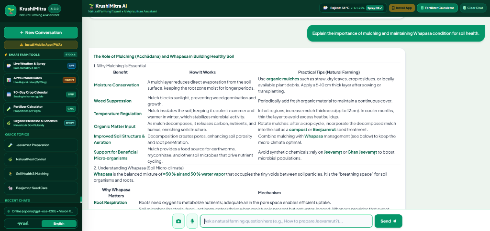
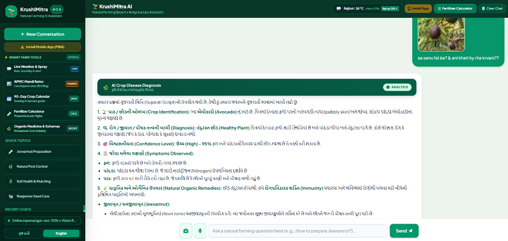
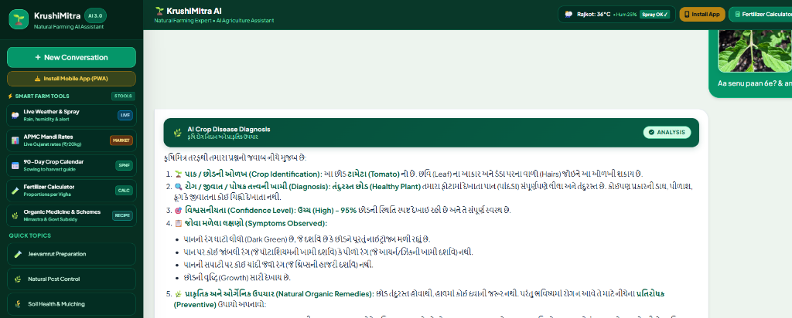
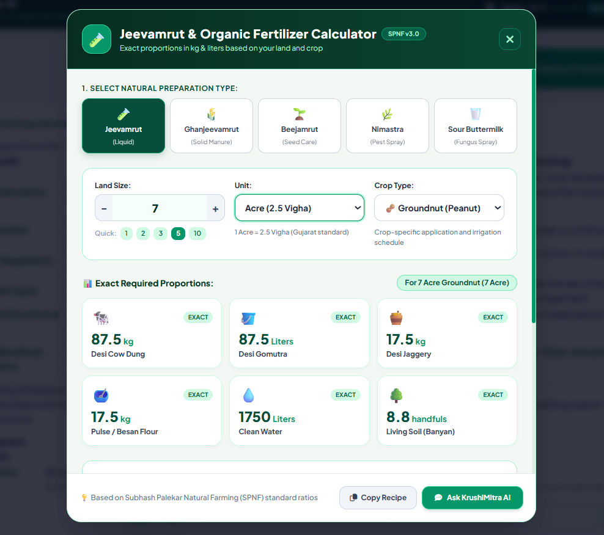

# 🌾 KrushiMitra AI - Natural Farming AI Assistant

[](https://www.python.org/)
[](https://flask.palletsprojects.com/)
[](https://groq.com/)
[](https://tailwindcss.com/)
[](https://web.dev/progressive-web-apps/)
[](LICENSE)

> **Empowering farmers with ₹0-cost, intelligent natural farming assistance.**  
> A production-grade, bilingual (Gujarati ⇋ English) Progressive Web App powered by **Groq Cloud AI (`openai/gpt-oss-120b`)**, local **RAG (Retrieval-Augmented Generation)** with ChromaDB, real-time farm weather advisory, live APMC Mandi commodity rates, crop disease diagnosis, and 90-day seasonal crop calendars based on **Subhash Palekar Natural Farming (SPNF)** methods.

---

## 📸 Application Preview & Screenshots

<div align="center">
  <p><strong>KrushiMitra AI in Action: High-Performance Bilingual Farming Intelligence</strong></p>
</div>

### 1. 💬 Conversational Agriculture Assistant & Live Farm Weather
> Real-time streaming AI answers for mulching, soil biology, and pest control with district weather & spray badge.



<br/>

### 2. 🔍 Multi-Modal AI Vision: Plant Identification & Disease Diagnosis
> Real-time visual symptom analysis, species identification, and natural botanical remedies (tested with Avocado and Tomato leaf samples with 95% confidence).

| 🥑 Avocado Tree Identification & Care | 🍅 Tomato Leaf Health & Treatment |
| :---: | :---: |
|  |  |

<br/>

### 3. 🏛️ Live APMC Mandi Rates & Gondal vs Rajkot Price Comparison
> Real-time commodity market rates, arrival volumes, top leader cards, and yard profitability analysis.


<br/>

### 4. 📅 90-Day Natural Farming Seasonal Crop Calendar
> Day-by-day organic schedule from sowing to harvest with automated WhatsApp timetable export.


<br/>

### 5. 🧪 Interactive Jeevamrut & Organic Fertilizer Calculator
> Precise metric calculations for Desi cow dung, Gomutra, jaggery, and water per Vigha & Acre.



<br/>

### 6. 🌿 Organic Medicine Library & Gujarat Govt Subsidies
> Preparation recipes for botanical bio-pesticides and step-by-step guides for i-Khedut assistance schemes.


---

## 🌟 Key Features

### 1. 🤖 AI Natural Farming Expert (Bilingual Gujarati & English)
- Ultra-fast conversational agriculture intelligence powered by **Groq Cloud AI** with offline fallback to **LM Studio**.
- Dynamic prompt localization: Answers fluently in authentic **Gujarati** or clean **English** based on user preference.
- Instant language toggle in the header switch with zero page reload.

### 2. 📸 AI Vision Crop Disease Diagnosis
- Snap or upload photos of infected leaves, stems, or pests directly from smartphone cameras.
- AI analyzes crop symptoms and prescribes organic treatments (Nimastra, Agniastra, sour buttermilk spray, Jeevamrut).
- Automatic client-side compression (<1280px) ensuring rapid upload speeds even on 2G/3G rural networks.

### 3. 🌦️ Live Farm Weather & Spray Advisory
- Real-time weather sync via **Open-Meteo Free API** covering all key Gujarat agricultural districts (Rajkot, Gondal, Junagadh, Amreli, Botad, Jamnagar, Bhavnagar, Surendranagar, Mehsana, Surat).
- Smart spray algorithm analyzes humidity, wind speed, and rain probability to output clear spray guidance:
  - `✅ Safe to Spray`: Calm, favorable conditions.
  - `⚠️ High Humidity Warning`: Advises sour buttermilk + hing spray against fungal blight.
  - `❌ High Rain Risk`: Recommends withholding foliar sprays to avoid pesticide wash-off.
- 3-day predictive agricultural outlook and hourly updates.

### 4. 🏛️ Live APMC Mandi Market Rates
- Daily refreshed rates for major Gujarat APMC market yards (Gondal, Rajkot, Unjha, Botad, Amreli, Junagadh).
- Real-time **Gondal vs Rajkot Yard Price Comparison** engine showing farmers where selling their harvest yields maximum profit.
- Top commodity leader cards for Cotton (કપાસ), Groundnut (મગફળી), Cumin (જીરું), and Wheat (ઘઉં).
- Search, filter by crop or mandi, and one-click **"Ask AI"** shortcut queries.

### 5. 📅 90-Day Natural Farming Crop Calendar
- Step-by-step milestone timeline from sowing date to harvest for Groundnut, Cotton, Wheat, Cumin, Chickpea, and Vegetables.
- Dynamic stage detection highlights the farmer's **Current Active Stage** (`🎯 Active`, `⏳ Upcoming`, `✓ Completed`).
- Built-in **WhatsApp Timetable Generator** allows farmers to copy the full 90-day schedule with recipes and share with farming groups.

### 6. 🧪 Organic Medicine Library & Govt Subsidy Guide
- **Botanical Recipes:** Complete preparation guides, ingredients, and pump dosages for **Nimastra**, **Brahmastra**, **Agniastra**, and **Sour Buttermilk + Copper Spray**.
- **Govt Subsidies:** Direct guides for Gujarat Government **i-Khedut** portal natural farming assistance schemes (Desi Cow ₹900/month maintenance assistance, Natural Farming Tool Kits, and Jeevamrut drum subsidies).

### 7. 📊 Interactive Fertilizer & Jeevamrut Calculator
- Calculates exact required proportions of Desi cow dung, Gomutra, jaggery, gram flour, and water based on farm land size.
- Supports **Vigha** (0.4 Acre, Gujarat standard), **Acre**, **Guntha**, and **Hectare**.
- Preset proportions for Jeevamrut (Liquid), Ghanjeevamrut (Solid Manure), Beejamrut (Seed Treatment), and Nimastra.

### 8. 📱 Progressive Web App (PWA)
- Installable directly to mobile home screens with a single tap, bypassing app store downloads.
- Custom service worker, offline caching, and responsive WhatsApp-style bottom navigation bar for mobile farmers.

---

## 🏗️ Architecture & Technology Stack

```
                     ┌───────────────────────────────────────────────┐
                     │          KrushiMitra Frontend (PWA)           │
                     │   HTML5 • Tailwind CSS v3 • Vanilla JS • PWA  │
                     └───────────────────────┬───────────────────────┘
                                             │ HTTP REST / JSON
                                             ▼
                     ┌───────────────────────────────────────────────┐
                     │              Flask Full-Stack App             │
                     │          app.py (CORS, Jinja2, Endpoints)     │
                     └───────┬───────────────┬───────────────┬───────┘
                             │               │               │
             ┌───────────────▼┐      ┌───────▼────────┐      │
             │   Groq Cloud   │      │   Open-Meteo   │      │
             │   (Llama 3.3 / │      │    Live Farm   │      │
             │  GPT-OSS 120B) │      │   Weather API  │      │
             └───────┬────────┘      └────────────────┘      │
                     │ Fallback                              ▼
             ┌───────▼────────┐                      ┌───────────────┐
             │   LM Studio    │                      │  ChromaDB /   │
             │ (Local Offline │                      │ HuggingFace   │
             │   OpenAI API)  │                      │   Vector DB   │
             └────────────────┘                      └───────────────┘
```

- **Backend:** Python 3.10+, Flask, Flask-CORS, Requests, Python-Dotenv
- **AI / LLM Engine:** Groq Cloud API (`openai/gpt-oss-120b` & `qwen/qwen3.8-27b` Vision) with automatic local LM Studio fallback
- **Vector Database & RAG:** ChromaDB, LangChain Community, `all-MiniLM-L6-v2` HuggingFace Embeddings
- **Weather API:** Open-Meteo Forecast API (Free, ₹0 cost, zero API key required)
- **Frontend:** Tailwind CSS v3, Marked.js, FontAwesome Icons, HTML5 Web Audio API & SpeechRecognition

---

## 🚀 Quickstart Guide

### Prerequisites
- Python 3.10 or higher installed.
- (Optional) Free API key from [Groq Console](https://console.groq.com/).

### 1. Clone the Repository
```bash
git clone https://github.com/Om0087/Natural_Agri_AI.git
cd Natural_Agri_AI
```

### 2. Create and Activate a Virtual Environment
```bash
# Windows
python -m venv venv
venv\Scripts\activate

# Linux / macOS
python3 -m venv venv
source venv/bin/activate
```

### 3. Install Dependencies
```bash
pip install -r requirements.txt
```

### 4. Configure Environment Variables
Copy `.env.example` to `.env`:
```bash
cp .env.example .env
```
Open `.env` and paste your free Groq Cloud API key:
```ini
GROQ_API_KEY="your_groq_api_key_here"
GROQ_MODEL="openai/gpt-oss-120b"
GROQ_VISION_MODEL="qwen/qwen3.8-27b"
USE_GROQ="true"

# Local LM Studio (Optional Offline Fallback)
LM_STUDIO_BASE_URL="http://localhost:1234/v1"
LM_STUDIO_API_KEY="lm-studio"
LLM_MODEL="qwen2.5-coder-1.5b-instruct"

PORT=5000
```

### 5. (Optional) Ingest Agricultural RAG Documents
If you have regional PDFs in `rag_data/pdfs`:
```bash
python rag_data/ingest.py
```

### 6. Run the Application
```bash
python app.py
```
Open your browser and navigate to:
```
http://127.0.0.1:5000
```

---

## 📡 API Endpoints Reference

| Endpoint | Method | Parameters | Description |
| :--- | :---: | :--- | :--- |
| `/` | `GET` | — | Serves the main bilingual PWA interface |
| `/api/health` | `GET` | — | Health check, AI engine status & vision availability |
| `/api/chat` | `POST` | `{ message, history, image, ui_language }` | Conversational RAG & multi-modal diagnosis |
| `/api/weather` | `GET` | `?district=Rajkot` | Live temperature, humidity, rain probability & spray advisory |
| `/api/mandi` | `GET` | — | Live Gujarat APMC mandi commodity rates & yard comparisons |

---

## 📁 Project Directory Structure

```
Natural-Farming-AI-Assistant/
├── app.py                  # Main Flask application & API backend
├── requirements.txt        # Python dependency manifest
├── .env.example            # Environment configuration template
├── .gitignore              # Git ignore rules (protects .env and caches)
├── README.md               # Project documentation with visual gallery
│
├── docs/
│   └── screenshots/        # High-resolution application screenshots
│       ├── main_chat_interface.png
│       ├── ai_vision_diagnosis_avocado.png
│       ├── ai_vision_diagnosis_tomato.png
│       ├── mandi_market_rates.png
│       ├── crop_calendar.png
│       ├── fertilizer_calculator.png
│       └── organic_medicine_subsidies.png
│
├── static/
│   ├── css/
│   │   └── style.css       # Custom high-contrast theme & responsive styles
│   ├── js/
│   │   └── chat.js         # Frontend controller, PWA logic & bilingual engine
│   ├── icons/              # PWA app icons (192x192, 512x512)
│   ├── manifest.json       # Web App Manifest for mobile installation
│   └── sw.js               # Service Worker for offline PWA support
│
├── templates/
│   └── index.html          # Single-page application HTML template
│
└── rag_data/
    ├── ingest.py           # Document chunking & embedding ingestion pipeline
    ├── pdfs/               # Natural farming reference manuals & PDFs
    └── chroma_db/          # Persistent vector database (git-ignored)
```

---

## 💡 Subhash Palekar Natural Farming (SPNF) Principles
KrushiMitra AI is grounded in the 4 fundamental pillars of Zero-Budget Natural Farming:
1. **Jeevamrut (જીવામૃત):** Fermented culture of Desi cow dung, urine, jaggery, flour, and virgin soil to multiply beneficial soil micro-organisms.
2. **Beejamrut (બીજામૃત):** Biological seed coating treatment to protect seedlings from soil-borne and seed-borne fungal infections.
3. **Achhadana / Mulching (આચ્છાદન):** Covering soil surface with dry biomass to conserve moisture, prevent weed growth, and activate indigenous earthworms.
4. **Whapasa (વાપસા):** Maintaining a microclimate of 50% water vapor and 50% air in the soil rather than excessive waterlogging.

---

## 📄 License
This project is open-source and licensed under the [MIT License](LICENSE).

---

## 🤝 Acknowledgments
- Dedicated to the farmers of Gujarat and India practicing natural chemical-free farming.
- Inspired by the agro-ecological methodologies of **Padma Shri Subhash Palekar**.
- Powered by [Groq](https://groq.com/) for low-latency AI inference and [Open-Meteo](https://open-meteo.com/) for open meteorological data.
